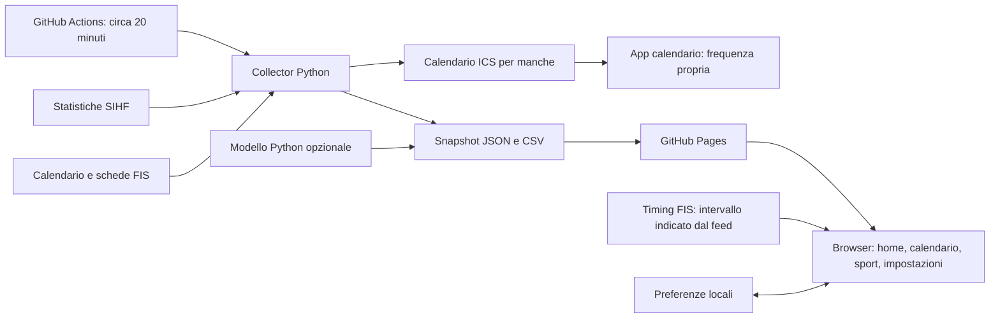
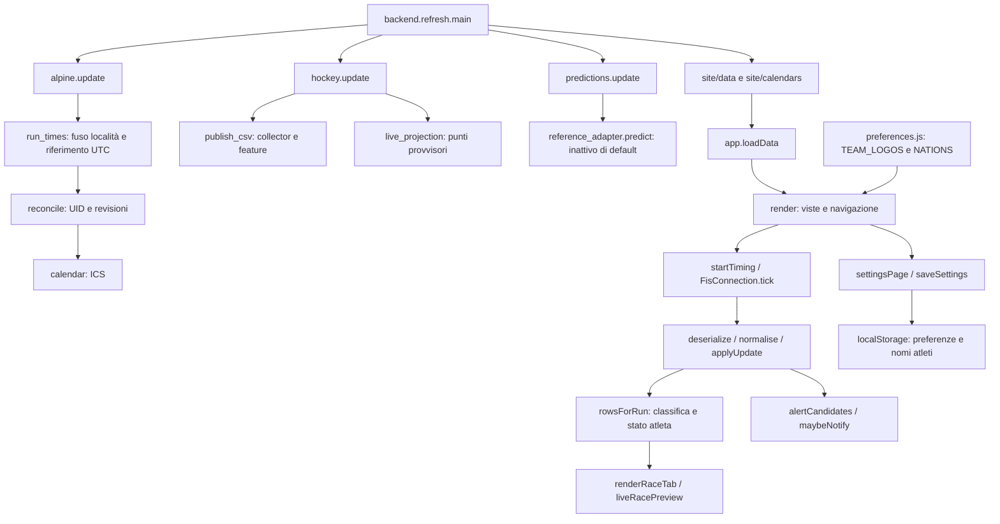

# Live Sport Arena: architettura

## Schema generale

Il browser rilegge gli snapshot ogni minuto quando la pagina è visibile. Questo non rende più frequente la raccolta hockey: i nuovi dati dipendono dal workflow. Il timing FIS è invece diretto, normalmente ogni 6 secondi, con riallineamento completo circa ogni minuto. Actions può subire ritardi.

## Schema tecnico

## Parti e responsabilità

| File | Responsabilità e ingressi principali |
| --- | --- |
| `backend/refresh.py` | Orchestrazione; `season`, `only`, `details`; conserva snapshot validi in caso di errore. |
| `backend/common.py` | Cache, richieste, timestamp e salvataggio JSON. |
| `backend/htmltree.py` | Lettura della struttura delle pagine FIS. |
| `backend/alpine.py` | `update(season)`, `run_times(event, timezone)`, `reconcile(events, old_events)`, `calendar(events)`. |
| `backend/alpine_standings.py` | Classifiche FIS WC: `update(season)` e `parse_standings(html, season, gender, identities)`; generale, DH, SL, GS e SG per donne e uomini. |
| `site/assets/alpine-insights.js` | `raceResults`, `raceTime`, `seasonMetrics`: ultimo vincitore e statistiche con copertura dichiarata. |
| `backend/fis_wire.py` | Decodifica del formato del timing lato Python. |
| `backend/hockey.py` | Raccolta SIHF, dettagli e CSV; `live_projection(standings, games)` protegge dai doppi conteggi. |
| `backend/hockey_csv.py` | Conversione del notebook; storico, statistiche, feature pregara e CSV. |
| `backend/predictions.py` | Giornata target, validazione delle probabilità e blocco con dati obsoleti. |
| `models/hockey/` | Configurazione e modello di riferimento opzionale. |
| `site/assets/app.js` | Stato UI, routing hash, filtri, viste, modali, preferiti, notifiche e aggiornamenti. |
| `site/assets/fis-live.js` | `FisConnection(race,onChange,onError)`, parser sicuro, aggiornamenti e candidati agli avvisi. |
| `site/assets/preferences.js` | Corrispondenza ID squadre/loghi, nazioni/colori, scelta classifica ufficiale/provvisoria. |
| `site/assets/modules.js` | Registro dei moduli sportivi e relativi snapshot. |
| `site/assets/style.css` | Responsive layout, colori, stati live e preferiti. |
| `.github/workflows/pages.yml` | Raccolta, cache e pubblicazione della sola cartella site. |

[Flussi dei dati e limiti](FLUSSI.md) · [Guida tecnica](../GUIDA-TECNICA.md)

## Nuove componenti

- `backend/hockey_statistics.py`: acquisizione delle 24 categorie SIHF con cache di un’ora e gestione errori per tabella.
- `site/data/tracks.json`: archivio locale dei tracciati, gestito durante lo sviluppo.
- `site/assets/course-map.js`: proiezione e visualizzazione SVG delle sole geometrie con fonte e coordinate valide.
- `detailPage`, `openGame`, `openRace`, `gameExtra`: pagine evento e anteprime con dati condivisi.
- `hockeyWidgets`, `hockeyStatisticsPage`, `allColumns`: widget e statistiche stagionali.
- Route `#game/ID`, `#race/ID`, `#hockey-stats`.

[Stato della consegna](CONSEGNA.md) · [Copertura tracciati e manutenzione](TRACCIATI.md).
